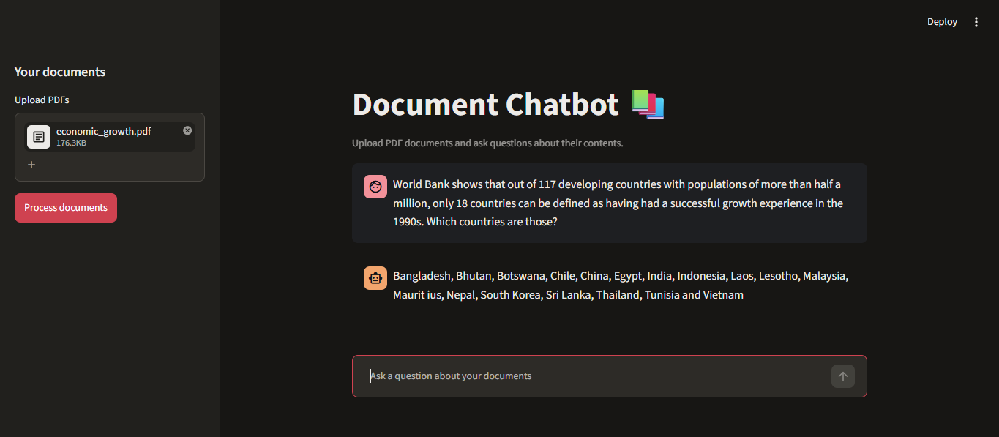

# Document Chatbot



### Objective

The objective of this project is to let users ask questions about information contained in PDF documents. Users upload one or more PDFs through a Streamlit interface and chat with an AI assistant that retrieves relevant passages to help answer their questions.

### Backend

The backend is a FastAPI service. It accepts PDF uploads, extracts their text, splits it into overlapping chunks, creates Hugging Face sentence embeddings, and stores the chunks in a FAISS index. It exposes endpoints for processing documents and asking questions. Conversation chains are kept in memory by the backend, so active conversations are cleared when the backend restarts.

The backend uses `sentence-transformers/all-MiniLM-L6-v2` for embeddings and runs `google/flan-t5-base` locally for answer generation. Both models are downloaded from the Hugging Face Hub on first use; inference runs on the local machine and does not use a paid inference provider. Model and chunk settings are in `backend/app/config.py`.

PDF text extraction does not perform OCR. Scanned image-only PDFs need to be OCR processed before upload.

### Frontend

The frontend is a Streamlit app in `frontend/app.py`. It uploads PDFs to the FastAPI backend and sends chat questions to the backend API. The API URL can be configured with `DOCUMENT_CHATBOT_API_URL`.

### Project Structure

```text
Document Chatbot/
|-- backend/
|   |-- app/
|   |   |-- config.py              # Backend settings
|   |   |-- documents.py           # PDF extraction and text splitting
|   |   |-- main.py                # FastAPI endpoints
|   |   |-- retrieval.py           # Embeddings, FAISS, and chat chain
|   |   `-- service.py             # Backend application services
|   `-- __init__.py
|-- frontend/
|   |-- app.py                     # Streamlit user interface
|   `-- __init__.py
|-- data/samples/                  # Optional local sample PDF (git-ignored)
|-- .env.example                   # Environment variable template
|-- requirements.txt               # Python dependencies
`-- README.md
```

### Run the Application

Use Python 3.10 or 3.11. Create and activate a virtual environment:

```bash
python -m venv .venv
```

On Windows:

```powershell
.venv\Scripts\Activate.ps1
```

On macOS or Linux:

```bash
source .venv/bin/activate
```

Install dependencies:

```bash
pip install --upgrade -r requirements.txt
```

The project pins Transformers to version 4.x because the local FLAN-T5 pipeline uses `text2text-generation`, which Transformers 5 removed.

Copy `.env.example` to `.env`. A Hugging Face token is not required for the public models used by this project. Keep `.env` private; it is excluded by `.gitignore`.

Start the FastAPI backend from the project root:

```bash
uvicorn backend.app.main:app --reload
```

The API documentation is available at `http://127.0.0.1:8000/docs` while the backend is running.

In a second terminal, activate the same virtual environment and start the Streamlit frontend:

```bash
streamlit run frontend/app.py
```

Upload PDFs in the sidebar, select **Process documents**, and ask a question in the chat input.

The first document-processing request downloads the local embedding and language models, so it may take a few minutes and requires an internet connection and enough disk space. Later requests reuse the cached models. Answer generation uses your machine's CPU by default and will be slower than a hosted inference service.

